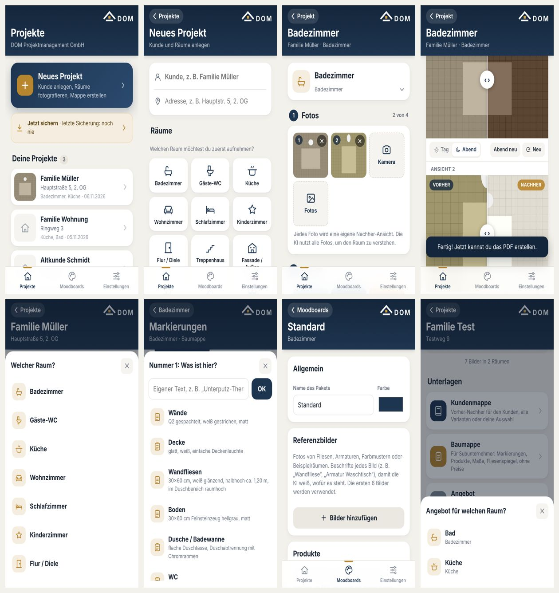
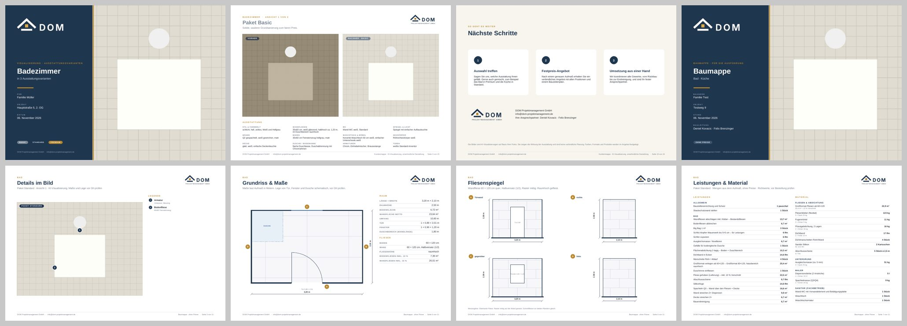

# DOM – Sanierungs-Visualisierung (Web-App fürs iPhone)

Kunde anlegen → Räume fotografieren → KI zeigt jeden Raum in Basic / Standard / Premium → schöne Mappen als PDF:
**Kundenmappe** (Vorher-Nachher) und **Baumappe** für Subunternehmer (Markierungen, Produkte, Grundriss, Fliesenspiegel, ohne Preise).

## So ist die App aufgebaut
- **Projekte** (Tab 1): ein Projekt = ein Kunde mit Adresse und beliebig vielen Räumen.
  - Raum: 1 Fotos, 2 Pakete wählen und visualisieren (optional Abendstimmung), 3 Ergebnis mit Vorher-Nachher-Schieberegler, 4 Aufmaß & Angebot, Markierungen, Instagram.
  - Unterlagen im Projekt: Kundenmappe, Baumappe, Angebot.
- **Moodboards** (Tab 2): je Raumtyp drei Pakete mit Beschreibung, Referenzbildern und echten Produkten.
- **Einstellungen** (Tab 3): Firma und Logo, Google-Schlüssel, Preisliste, Sicherung, Cloud-Abgleich.

## Daten
- Alles liegt lokal auf dem Gerät (IndexedDB `sanierung`, Store `kv`).
  - `wohnung:<id>`: Projekt (Kunde, Adresse, Reihenfolge der Räume, Mappen-Auswahl).
  - `project:<id>`: Raum (Fotos, Ergebnisse, Abendbilder, Aufmaß, Angebot, Baumappe `bau`), mit `wohnungId`.
  - `projectIndex`: Projektliste. `boards`, `settings`, `preisliste`, `angebotVorlagen`, `projectDeleted` (Löschmarken für den Abgleich).
- Alte Einzelprojekte werden beim Start automatisch in ein Projekt mit einem Raum umgestellt (`Projekt.migrate`, ID `p<RaumId>`, auf allen Geräten gleich). Nichts wird gelöscht.

## Dateien
- `core.js`: Grundfunktionen (Speicher, Bilder, KI-Aufruf `renderWithGemini`/`geminiImage`, Prompt `buildPrompt`, Abendstimmung, Schieberegler, KI-Aufträge)
- `app.js`: Icons, Kopfzeile, Projektliste, Raum-Ansicht, Start
- `projekt.js`: Projekte mit Räumen, Umstellung alter Daten, Auswahl für die Kundenmappe
- `pdf.js`: gemeinsames PDF-Design (Deckblatt, Kopf-/Fußzeilen) und die Kundenmappe
- `baumappe.js`: Markierungen im Bild und die Baumappe (Grundriss, Fliesenspiegel, Leistungen und Material)
- `moodboards.js`: Moodboards und Einstellungen
- `angebot.js`: Aufmaß, Angebot, Material, Bauzeitenplan, Excel-Import
- `garten.js`: Garten/Heizraum, Wärmepumpe mit Meterstab-Maßstab einsetzen
- `voice.js`: Sprachnotiz → Kundenwünsche
- `social.js`: Instagram-Video und Post-Bilder
- `backup.js`: Komplettsicherung, `sync.js`: Cloud-Abgleich über Supabase (`SUPABASE_EINRICHTEN.md`)
- `rooms.js`: Raumtypen und Beispiel-Pakete, `sw.js`: Offline-Cache (bei Änderungen `VERSION` erhöhen)

## Aufs iPhone bringen
1. Online über GitHub Pages: https://felix260796.github.io/dom-app/
2. Auf dem iPhone in Safari öffnen → Teilen → „Zum Home-Bildschirm“.
3. In der App unter Einstellungen den Gemini-API-Schlüssel eintragen (https://aistudio.google.com/apikey).
